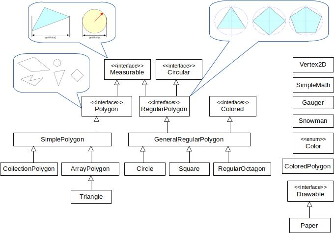
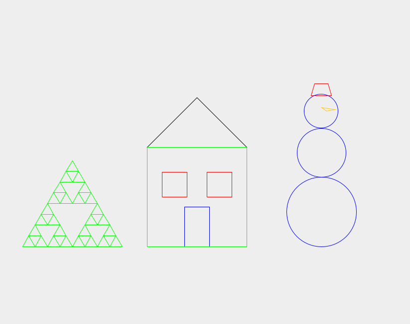

# 2D Geometry Modeling Library

## Overview
An object-oriented Java library for modeling, measuring and manipulating 2D geometric shapes, built as a university project during my Business Informatics studies at Masaryk University. It includes a class hierarchy ranging from basic vertices to recursively subdivided polygons, a drawing canvas simulation and a small Swing GUI that renders the shapes.

The goal of the project was to practise core software engineering principles: encapsulation, polymorphism, interfaces, a design pattern and effective use of the Java standard library.

## Key Features
* **Shape hierarchy:** simple polygons, regular polygons, circles, squares, octagons and triangles.
* **Drawing simulation:** a `Paper` canvas (implementing the `Drawable` interface) that tracks unique shapes, prevents duplicates and manages colors.
* **Recursive subdivision:** triangles can be recursively divided into smaller sub-triangles to a given depth (similar to the Sierpiński triangle).
* **Shape composition:** basic shapes are combined into more complex objects, e.g. a `Snowman` built from circles with a reduction factor.

## Architecture & Design


The project has two main branches:
1. **Simple polygons** are defined by explicit vertices, with an array-backed (`ArrayPolygon`) and a list-backed (`CollectionPolygon`) implementation.
2. **Regular polygons** are defined by a center and a radius (`GeneralRegularPolygon`). `Circle`, `Square` and `RegularOctagon` build on this class and fix the number of edges.

### Concepts Practised
* **Interfaces and abstract classes:** contracts defined by `Measurable`, `Circular`, `Drawable` and `Polygon`; shared behavior in the abstract class `SimplePolygon`.
* **Decorator pattern:** `ColoredPolygon` adds a color to any existing `Polygon` without changing the original class.
* **Immutability:** `Vertex2D` and `ArrayPolygon` are immutable; arrays are defensively copied in constructors.

## Visual Demonstration



`VisualDemo.java` is a Java Swing window that renders the shapes drawn on the `Paper` canvas.

### How to Run
The source files declare packages under `cz.muni.fi.pb112.project`, so compile them into an output folder and run the demo by its full class name.

From the repository root:
```bash
javac -d out *.java
java -cp out cz.muni.fi.pb112.project.VisualDemo
```

Alternatively, open the folder in an IDE (IntelliJ IDEA, Eclipse or VS Code) and run the `main` method in `VisualDemo.java`.
